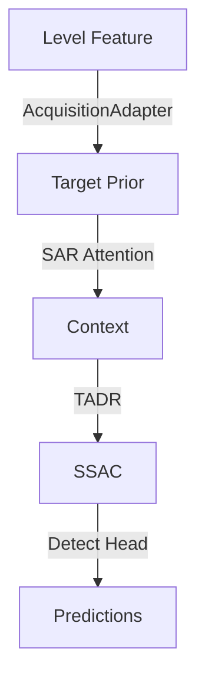

# SAR-YOLO: Architecture

## Architectural Style
**Layered architecture** with a YOLO11 backbone and a neck of SAR-specific modules. The design is **module-based**: every SAR-specific component is a drop-in replacement for a stock YOLO layer, preserving the channel count and the residual-gate contract (alpha = 0 at init).

## Major Subsystems

### 1. Input Representation (Row 0 of Backbone)
The first backbone row is where SAR-specific input processing happens.

- **Ratio-space CFAR front end** (`RatioSpaceCFARFrontEnd`): Analytic multi-scale CFAR statistic computed before the first convolution. Replaces raw intensity with a learned gain over the CFAR statistic stack (log-ratio + local coefficient of variation).
  - Modes: `cfar` (proposed), `conv` (matched-cost control: raw intensity), `fixed` (fixed-threshold control)
  - Identity at init in `cfar` and `conv` modes; `fixed` mode is deliberately not an identity
  - Modes: `cfar`, `conv`, `fixed`

- **SAR Input Adapter** (`SARInputAdapter`, Module A): Operates on the image before the first convolution. Four modes:
  - `identity`: raw intensity, zero parameters
  - `local`: local-statistics representation only (mean, std, high-pass)
  - `learned`: learned representation only, no explicit statistics
  - `hybrid`: proposed — both streams fused by learned 1x1 projection
  - All modes are channel-preserving and identity at init (via ZeroGate)

### 2. Backbone Feature Extraction
Standard YOLO11 backbone building blocks, extended with SAR modules inserted at specific positions.

- **P1/2** (Conv 64, k3, s2): First downsampling
- **P2/4** (C3k2 256, repeats 2): Second stage
- **P3/8** (Conv 128→256, k3, s2) + **SFE** (Component 1, optional): Enhancement on highest-resolution retained feature
- **P4/16** (C3k2 512, repeats 2) + **SFM** (Component 2, optional): Speckle/clutter discrimination
- **P5/32** (Conv 512→1024, k3, s2) + **SPPF** (SPPF 1024, k5) + **SFR** (Component 9, optional): Spectral frequency branch — the cheapest stage to attach FFT (P5/32 has 10×10 spatial map)
- **P5 C3k2** also consumed by **Speckle-Aware Feature Module** (Component 2, optional) when mode is `sfm_clutter`

**Top-down pathway** (FPN):
- Upsample P5 → add P4 → C3k2 P4
- Upsample P4 → add P3 → C3k2 P3
- Optionally: upsample P3 → add P2 → C3k2 P2 (when P2 head enabled)

**Bottom-up pathway**:
- Downsample from P2 → lateral connections to P3, P4, P5

### 3. Per-Level Research Slots (Immediately Pre-Head)
Every detection level (p2/p3/p4/p5) has the same chain of research slots, wired in this exact order:

1. **AcquisitionConditionedAdapter** (optional): Reads per-image metadata (sensor, resolution, gain, mode). Placed first so every later slot operates on acquisition-conditioned features.
2. **TargetPriorModulation** (Component 8, optional, mode: learned/channel/static/cfar/spectral/spectral_feat/none): Signed, content-adaptive prior map. Modulates features multiplicatively. `spectral` arm also selects radial frequency bands (Module G). `spectral_feat` is the matched-capacity control (raw features instead of prior evidence).
3. **SARAdaptiveAttention** (Component 3, optional, gate: adaptive/static): Channel + spatial + local-contrast evidence, adaptively fused with per-sample softmax weights. `static` ablation isolates adaptivity from having three branches.
4. **ContextAggregation** (Component 10, optional, mode: multi/local/regional/none): Multi-extent spatial context (dilated depth-wise convs) + regional/channel context. All arms are identity at init via zero-gate.
5. **TargetAwareRefinement** (Component 11, optional, mode: deform/static/local/none): Per-sample offset sampling via grid_sample. `local` is the capacity control (same sub-network, no offsets). `deform` is the proposed arm. `static` is learned but input-independent.
6. **ScatterSelectiveRefinement** (SSAC, optional, mode: adaptive/adaptive_raw/fixed, execution: dense/sparse): Per-region allocation of expensive computation. `adaptive` = proposal (SAR statistic drives allocation). `adaptive_raw` = assessment alternative (raw features instead of statistic). `fixed` = matched fixed-computation control (spatially constant allocation). `dense` runs expensive path everywhere; `sparse` runs it only on selected tiles.
7. **Detection head** (`Detect`): Reads the finest-level output (p3 features by default, or p2/p3/p4/p5 when P2 enabled).

**Key design notes on the per-level chain**:
- Order matters: prior → attention → context → refinement → SSAC → head. Each slot modulates the feature for the next.
- Prior comes first so attention, context and refinement operate on target-modulated features.
- SSAC acts last so the detection head reads the adaptively-refined representation.
- Every slot preserves channel count (channel-preserving design).
- Every residual gate starts at 0 → exact identity at init.

### 4. Efficiency Frontier (SARVO-Lite)
The light arm that removes the two dominant compute slots while retaining all physical priors:

- **SARVO-Lite (s)**: 11.016 M params, 32.55 GFLOPs at scale s (42% reduction from full v2)
- Removes: **Context Aggregation** (+1.16 M / +2.75 G) and **Adaptive Multi-Scale Fusion** (+4.05 M / +20.38 G)
- Keeps: SFE, SFM (clutter-aware), SFR, TPM, TADR, P2 head, SAR loss
- The two removed slots together are ~42% of full v2's compute

### 5. SAR-Aware Loss (Criterion)
Custom criterion with these terms (from YAML `sar_loss` block):
- `w_sep`: Separation term — encourages different predictions for different target types
- `w_small`: Small-target term — emphasizes learning on small objects
- `w_smooth`: Smoothness term — encourages stable predictions
- `margin`: Margin for the separation term
- `bg_frac`: Background fraction for loss computation

## Design Guarantees (The Three Constraints)

Every SAR-YOLO neck module must satisfy these to be wireable through `ultralytics.nn.tasks.parse_model`:

1. **Single input, single output**: `parse_model` resolves output channels with `c2 = ch[f]` for unknown modules, which breaks if `f` is a list. Every module takes one input tensor and produces one output tensor.

2. **Channel preserving**: Must return the same number of channels it received. The parser reports `c2 == c1` to the next layer, so the module must preserve channel count. Projection back to a new width is left to the stock `Conv`/`C3k2` that follows.

3. **Identity at initialisation**: Every residual gate starts at `alpha = 0`, so a freshly built SAR-YOLO is numerically identical to its YOLO baseline. Any improvement is attributable to learned SAR-specific behaviour, not extra capacity at init.

## Dependency Direction

```
Input Image
    ↓ (SIA, if enabled)
CFAR Front End (if enabled)
    ↓
Backbone (standard YOLO11 stages P1→P5)
    ↓
Top-down FPN pathway (upsample + add + C3k2)
    ↓
Per-level chain (p2→p5, optional):
    │
    ├── AcquisitionConditionedAdapter (if conditioned)
    ├── TargetPriorModulation (if enabled)
    ├── SARAdaptiveAttention (if enabled)
    ├── ContextAggregation (if enabled)
    ├── TargetAwareRefinement (if enabled)
    └── ScatterSelectiveRefinement (SSAC, if enabled)
        ↓
    Detect head
    ↓
SAR-Aware Loss (criterion)
```

## Mermaid Diagrams

### High-Level Architecture
```mermaid
graph TD
    A[Input Image] -->|SIA (Module A)| B[CFAR Front End]
    B --> C[YOLO11 Backbone]
    C -->|FPN Top-Down| D[Per-Level Chain]
    D -->|Acquisition Adapter| E[Target Prior]
    E -->|SAR Attention| F[Context Aggregation]
    F -->|TADR Refinement| G[SSAC]
    G --> H[Detect Head]
    H --> I[SAR-Aware Loss]
    I --> J[Predictions]
```

### Per-Level Chain (one detection level)


### Module Ablation Grid (simplified)
```mermaid
graph TB
    style fill:#f9f,stroke:#333,stroke-width:2px
    A[Full v2] -->|- Context| B[Lite v2]
    B -->|- AMF| C[SARVO-Lite]
    C -->|- P2| D[No P2 Lite]
```

## Application Lifecycle

### Initialization
1. Model YAML loaded by Ultralytics `parse_model`
2. `SARYOLODetectionModel.__init__` or `SARYOLORTDetectionModel.__init__` calls `attach_metadata_context()`
3. For every `AcquisitionConditionedAdapter` found, a shared `MetadataContext` is created
4. For every `ScatterSelectiveRefinement` found, SSAC defaults are recorded
5. `n_conditioned_adapters` is set on the model

### Configuration Loading
1. Experiment YAML (from `configs/exp/`) specifies which VARIANT is used
2. VARIANT defines which modules are enabled/disabled and their modes
3. `sar_loss` block (if present) provides criterion configuration
4. Metadata vocabulary (if conditioning enabled) is loaded from checkpoint

### Startup (Demo)
1. `streamlit run app.py` loads the default checkpoint `weights/sarvo_ssac001.pt`
2. `resolve_weights()` determines the weights path (env var or default)
3. Model loaded via `load_detector()`
4. User uploads SAR image or picks local sample
5. `predict_image()` runs inference: preprocess → forward → postprocess (NMS) → annotate

### Normal Execution (Training)
1. `python -m saryolo train --exp <config>` loads experiment config
2. Trainer builds model from VARIANT specification
3. `set_batch_metadata()` points the model's metadata context at the current batch
4. Forward pass: backbone → FPN → per-level chain → Detect
5. SAR-aware criterion computes loss (separation, small-target, smoothness, consistency if enabled)
6. Loss.backward() — every module's gate starts at 0, so initial gradients come from the SAR terms
7. Optimizer step
8. Logging: mAP50, mAP50:95, loss terms, SSAC gate means, etc.

### Shutdown
- Training: saves checkpoint at best mAP
- Evaluation: `python -m saryolo eval --weights <ckpt> --data <data.yaml>`
- Efficiency: `python -m saryolo efficiency --weights <ckpt> ...`
- Ledger: `python -m saryolo ledger` records every run

## Data Architecture

### Data Models
- **Image**: Grayscale SAR chip (single channel, replicated to 3 by Ultralytics for RGB-style model)
- **Metadata per image**: (continuous, categorical, availability) triple — e.g., (resolution_m, sensor_vv_vh, availability_present)
- **Ground truth**: YOLO format labels (class, x_center, y_center, width, height) in normalized coordinates
- **Detection predictions**: Class, confidence, bounding box (x_yxyx format)

### Database Schemas
No traditional database. Data is file-based:
- `datasets/processed/<dataset_name>/images/<split>/`
- `datasets/processed/<dataset_name>/labels/<split>/`
- `configs/datasets/<dataset_name>.yaml` — data config with paths, names, nc

### Serialization Formats
- **Model weights**: PyTorch `state_dict` (.pt file)
- **Experiment config**: YAML
- **Metadata table**: JSON (built by `saryolo metadata` command)
- **Results/ledger**: JSON lines (experiment tracking)
- **Prediction output**: JSON (from `predict_image`)

### Caching Structures
- `torch.cuda.graph` not used (CPU-only focus)
- Streamlit caching: `_load_cached(weights, mtime)` caches checkpoint load per (path, mtime)
- PyTorch JIT not used (modules contain dynamic control flow via gates)

## External Integrations

### Ultralytics YOLO
- **Framework**: Ultralytics YOLOv8 API (compatible with YOLO11 model structure)
- **Integration point**: `parse_model`, `DetectionModel` base class, trainer hooks
- **Custom layers**: 12+ SAR-specific modules registered via `saryolo.nn.register`
- **Version**: `ultralytics>=8.3.0`

### Streamlit
- **Framework**: Streamlit >= 1.30.0
- **Integration point**: `app.py` web demo
- **Purpose**: Web interface for inference, no training integration

### PyCocoTools
- **Package**: `pycocotools>=2.0.7`
- **Purpose**: COCO AP computation (mAP50, mAP50:95)
- **Integration**: `evaluation/metrics.py` — `reproduces_pycocotools` test verifies identical output

### Tensorboard
- **Package**: `tensorboard>=2.15.0` (optional, dev dependency)
- **Integration**: Experiment tracking, loss curves, mAP monitoring

### Matplotlib / Seaborn
- **Packages**: `matplotlib>=3.7.0`, `seaborn>=0.13.0`
- **Purpose**: Figure generation (cost frontiers, ablation tables, test composition)
- **Integration**: `paper/` table generators, `docs/assets/` figures

### THOP
- **Package**: `thop>=0.1.1`
- **Purpose**: FLOPs and parameter counting
- **Integration**: `evaluation/efficiency.py` — `profile_yaml`, `profile_model`

### Hugging Face Hub
- **Package**: `huggingface_hub>=0.23.0` (requirements.txt)
- **Purpose**: Dataset download assistance
- **Integration**: `data/convert.py` — some dataset acquisition paths

## Security Architecture

### Authentication
- No user authentication in the pipeline (research tool)
- Streamlit demo runs locally; hosted instances rely on Streamlit's built-in auth

### Authorization
- No fine-grained authorization needed
- Weight paths are user-configured; no path traversal beyond what the user permits

### Session Management
- No session state beyond Streamlit's default if hosted
- CLI has no session concept

### Input Validation
- Image validation in `validate_and_decode()`: format (jpg/png/bmp/tif), size (<8 MB), dimensions (32–6000 px per side)
- Weight path validation: `Path.is_file()` check before loading
- CLI dataset validation: `_dataset_splits()` raises SystemExit if splits missing

### Data Sanitization
- No user-supplied data enters the model forward pass in production
- Augmentation is shape-preserving SAR degradation (controlled severities)

### Secret Handling
- No secrets in the codebase
- `.env`, `*.key`, `secrets.json` are git-ignored
- Hugging Face token may be needed for dataset download (user-provided)

### CORS
- No CORS concerns (no HTTP server beyond Streamlit demo)
- Streamlit auto-handles CORS for hosted instances

### CSRF Protections
- Not applicable (no form submissions that mutate state)

### Rate Limiting
- Not applicable

### File Upload Validation
- Streamlit `file_uploader` limits: max 8 MB, types [jpg, jpeg, png, bmp, tif, tiff]
- `validate_and_decode()` rejects images outside valid range

### Access Control
- No access control needed (research tool, local-first)

### Sensitive Data Exposure Risks
- SAR imagery can be sensitive (military/naval imagery)
- Repository explicitly states: "This demo performs research inference, not operational surveillance"
- No automatic declassification or imagery sharing
- Users must ensure they have rights to any SAR images they upload

## Known Design Decisions (with Rationale)

### Why the CFAR front end is row 0
SAR's physics dictates that the first representation matters most: a stock detector's stem is trained on RGB photographs, consuming raw intensity as if it were an RGB channel. SAR intensity is multiplicative-speckle dominated with enormous dynamic range, and target evidence lives in local contrast/structure, not absolute level. The CFAR front end replaces the convolution-reads-raw-magnitude pattern with an analytically computed radar statistic, so the first convolution sees a more SAR-appropriate representation.

### Why SSAC acts last in the per-level chain
SSAC's allocation decision determines *how much* expensive computation each location receives. Placing it last means the detection head reads the adaptively-refined representation — the "allocation supports detection" claim is direct rather than indirect. If SSAC were placed earlier, the head would see partially refined features, making the claim harder to isolate.

### Why the per-level chain has a fixed order
The order prior → attention → context → refinement → SSAC → head is not arbitrary:
- **Prior first**: gives attention/context/refinement target-modulated features to work with
- **Attention second**: reweights features based on acquired prior
- **Context third**: aggregates wider scene context around the prior-attended feature
- **Refinement fourth**: lets each cell sample a slightly different location
- **SSAC fifth**: allocates expensive path only where evidence says so
- **Head last**: reads the final representation

Deviating from this order would change which intervention is "first seen" by downstream components, confounding the ablation ladder (each component must earn its place independently).

### Why Module G (spectral prior conditioning) lives in TPM rather than the spectral slot
The brief asks for the target prior to drive frequency-band selection. The obvious wiring (prior → spectral slot) is not expressible in Ultralytics YAMLs: `parse_model` resolves `c2 = ch[f]`, and only a hardcoded set of names (e.g., `CBFuse`) receives a channel *list*. More fundamentally, the backbone spectral slot runs at P5/32 *before* any prior exists, so a backward connection would be needed. Rather than fake the wiring, conditioning is implemented where the prior actually is: the same module produces the prior and lets it choose the spectrum. The `spectral_feat` arm then removes the confound (raw features instead of prior evidence at matched capacity).

### Why the P2 level must come with P3, P4, and P5
When P2 is enabled, levels must be `("p2", "p3", "p4", "p5")`. This is a hard constraint from the architecture builder: the FPN top-down pathway and bottom-up pathway are designed for a four-level pyramid, and P2 introduces a fifth level that the existing up/down sampling logic doesn't support without significant refactoring. The constraint ensures all generated YAMLs are internally consistent.

### Why every module is an exact identity at init
This is the repository's foundational design invariant. If a module were not an identity at init, a freshly built SAR-YOLO would differ from its baseline by an arbitrary amount, and any later accuracy difference would be attributable to initialization rather than training. The zero-initialised residual gate (`alpha = 0`) guarantees `out == F` at init. Every module's documentation asserts this property, and the test suite pins it (`test_each_module_is_exactly_identity_at_init`, `test_no_module_is_frozen_at_init`).

### Why the efficiency frontier removes context and AMF
Measurement shows these two slots together are ~42% of full v2's compute (context: +1.16 M / +2.75 G; AMF: +4.05 M / +20.38 G). They are the single largest cost lever available without touching the backbone. The ablation machinery already owns both slots (removal arms `v2_noctx`, `fus_*`), so the light arm cannot be a hidden change — it is an explicit selection.

### Why the allocation is per-region (SSAC) rather than per-pixel
The CFAR front end produces per-pixel gains; SSAC builds on that but operates at the *region* level (tiles of 16×16 feature map pixels). This choice balances two considerations:
1. **SAR targets are spatially extended enough** that a per-pixel allocation would be noisier than useful
2. **The gather/scatter overhead** of per-pixel refinement would be prohibitive (each pixel would need its own bilinear resample)
3. **The assessment statistic** (log-ratio + local CoV) is naturally computed over a window, so region-level allocation is consistent with the signal

### Why the CFAR uses log-ratio and coefficient of variation
- **Log-ratio** (`r_k = L - mu_k`: log of intensity / local mean): The CFAR decision variable itself. It is dimensionless, so the same threshold transfers between scenes of different absolute brightness. This is the same argument the front end's learned gain is built on.
- **Coefficient of variation** (`c_k = sqrt(var_k) / |mu_k|`): For fully developed speckle, `c_k^2` is the reciprocal of the equivalent number of looks (ENL). A region with high `c_k` relative to its scale is textured rather than a point return. Both statistics are dimensionless, enabling cross-scene transfer.

## Architectural Observations

### Identity-at-Init is the Foundation
Every claim in this repository rests on the property that a freshly built SAR-YOLO is numerically identical to its stock YOLO11 counterpart. This is verified by:
- `test_each_module_is_exactly_identity_at_init`: measures `max|f(x) - x| = 0.0e+00` for every module
- `test_no_module_is_frozen_at_init`: measures that every learnable mode has a non-zero gate gradient after 2 epochs of real training
- `test_models_output_identically_to_baseline_at_init`: max abs diff = 0.0 (v1 and v2)

### Controls Are Structural, Not Rhetorical
Every claim has a capacity-matched control built from the same graph:
- **SFE vs identity**: same slot, same init contract; difference is the enhancement mechanism
- **SFM vs none**: same slot; difference is speckle/clutter handling
- **SAA vs SE/EA/CA**: same slot, same init; difference is the attention mechanism
- **AMF vs concat/add/static**: same slot; difference is the fusion operator
- **TPM vs channel/static/cfar**: same slot; difference is how the prior is produced
- **SFR vs static/highpass/dct/wavelet**: same slot; difference is the frequency transform
- **CAG vs none/local/regional**: same slot; difference is the context extent
- **TADR vs local/static**: same slot; difference is the offset sampling
- **SSAC vs adaptive_raw/fixed**: same graph, same parameters; difference is the allocation logic
- **Conditional vs unconditional**: same architecture; difference is metadata consumption

When a claim survives its control, it is attributable to the mechanism, not the capacity.

### Scale Boundaries
- **YOLO11-n**: Smallest, fastest; 2.6 M params, used for smoke tests and CPU pipeline
- **YOLO11-s**: Main benchmark scale; 9.5 M params, the scale used for most experiments and the efficiency frontier
- **YOLO11-m**: Medium capacity; 20 M params (not fully wired in this repo, but the scale constant exists)
- **P2 level**: Adds a small-object head; when enabled, levels = (p2, p3, p4, p5). Small objects benefit from higher-resolution features.

### The Efficiency Frontier at Different Scales
- **SARVO-Lite (n)**: 3.043 M params, 11.71 GFLOPs — edge-deployment point
- **SARVO-Lite (m)**: 22.541 M params, 97.18 GFLOPs — scale-matched to v2 (m)
- Frontier holds at higher capacity: the two removed slots (context + AMF) are proportionally larger at smaller scales (their FLOP share is bigger when the backbone is smaller)

### Cross-Sensor Generalisation (LOSO)
The LOSO (leave-one-source-out) framework enables cross-sensor generalisation claims:
- Each fold holds out one sensor/source for testing
- Training on remaining sources; evaluation on held-out source
- If the adapter enables generalisation, the held-out source should perform better than without it
- Currently untested on real data; the machinery is committed and tested (synthetic LOSO folds work)

### Acquisition Conditioning
Two independent dimensions are wired:
- **Mode**: how the metadata modulates the feature (scale / shift / film / spatial). The point is to find the simplest design that works.
- **Field set**: which acquisition parameters are consumed. `continuous_only` uses only physically-ordered fields (resolution, band, incidence), so it can transfer to a sensor with no embedding row. If only the categorical arm helps, the claim fails on its own terms.

The `continuous_only` arm is the one that matters most for the headline claim: it uses only fields that a deployment is most likely to know (sensor model publishes resolution, band, incidence; these are not learned embeddings).

## Future Architectural Directions

### Cross-Level Routing
Currently, per-level routing cannot be expressed in Ultralytics YAMLs because:
- `parse_model` resolves unknown module output channels with `c2 = ch[f]`, which breaks if `f` is a list
- The `Detect` head uses a `frozenset` identity membership test; a subclass falls through to the generic path

Cross-level routing would require either patching `parse_model` (avoided so stock model summary, FLOPs counter, validator and checkpointing keep working) or a model-level mechanism declared outside the YAML. It is left out rather than faked.

### Alternative Frequency Transforms
The brief explicitly asks for DCT and Wavelet alternatives to FFT (SEC. 14). These are implemented as arms within the same `SpatialFrequencyRepresentation` module, sharing the band-parameterisation and interpolation infrastructure so parameter counts are directly comparable.

### Higher-Resolution Inference
Efficiency savings (sparse SSAC) are scale-bound: at 320 px training scale, no budget saves over dense; at 640 px, `keep = 0.25` achieves −6.43% and `keep = 0.1` achieves −8.45%. Future work could train at 640 px and evaluate efficiency there.

### Multi-Sensor Conditioning
Currently, conditioning is per-sample (each image's metadata modulates its own features). Future work could explore per-batch or per-window conditioning, or a learned embedding of the acquisition space.