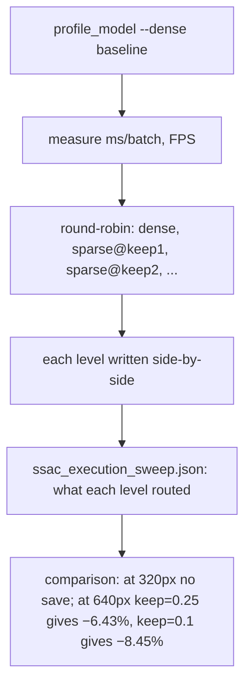

# SAR-YOLO: Execution and Data Flows

## Startup Flow

### Streamlit Demo (`streamlit run app.py`)

1. **Process start**: `if __name__ == "__main__": main()` in `app.py`
2. **Configuration loading**:
   - `_sidebar()` reads: checkpoint path, input size (320/512/640/800), confidence threshold, NMS IoU
   - `DEFAULT_WEIGHTS = resolve_weights()` or `""` (empty if nothing configured)
   - `resolve_weights()` checks `SARVO_WEIGHTS` env var, then documented default locations
3. **Model loading**:
   - `_load_or_error(weights)` validates the checkpoint path exists
   - `_load_cached(weights, mtime)` loads detector via `load_detector(weights, device="cpu")`, cached on (path, mtime)
   - If no weights configured: shows error "No checkpoint is configured. Set `SARVO_WEIGHTS`..."
   - If weights file doesn't exist: shows error with path guidance
   - If `CheckpointError`: propagates the error message
   - If other exception: shows "The checkpoint could not be loaded: {exc}"
4. **Model description**:
   - `describe_model(model, weights)` returns dict with: `params_M`, `checkpoint_MB`, `device`, `classes` (dict)
   - Displayed in 4-column metrics row
5. **Image input**:
   - `st.file_uploader()` for uploaded SAR image (types: jpg, jpeg, png, bmp, tif, tiff; max 8 MB; 32–6000 px per side)
   - `_pick_sample()` offers local val chips from `datasets/processed/hrsid_real/images/val` (HRSID, not committed with code)
   - If no upload and no sample: shows "Upload an image, or pick a local sample chip if one is available."
6. **Validation**:
   - `validate_and_decode(raw, filename)`: decodes image, checks format/size/dimensions
   - `InvalidImageError` → shows error + recovery info (re-export as PNG/JPG under 8 MB, 32–6000 px)
7. **Run detection**:
   - `st.button("Run Detection", type="primary")` must be pressed
   - `predict_image(model, image.array, imgsz=cfg["imgsz"], conf=cfg["conf"], iou=cfg["iou"], device="cpu", weights=cfg["weights"])`:
     - Preprocess: validate_and_decode already returned decoded array
     - Forward pass through model on CPU at configured imgsz
     - NMS (non-maximum suppression) at configured conf and iou thresholds
     - Postprocess: format detections as result object with `detections`, `latency_ms`, `as_rows()`
   - `annotate_image(image.array, result.detections, class_names(model))`: draws boxes on image
   - Display: annotated image + metrics (detections, latency, throughput)
8. **Limitations expander**: always shows disclaimers about one dataset/subset/class, no cross-sensor result, CPU-only, raw model output, research not surveillance

### CLI Entry Points

`saryolo <command>` routes to one of 19 subcommands via `cli.py`:
- `datasets` → list supported SAR datasets
- `synth-data` → generate synthetic dataset (pipeline testing only)
- `check-data` → validate a YOLO dataset (images/labels splits)
- `stats` → profile dataset (statistics, figures)
- `metadata` → build acquisition-metadata table
- `probe` → representation diagnosis on frozen checkpoint
- `arch` → generate YAML variant files
- `train` → run experiment (run_experiment in training/runner.py)
- `eval` → evaluate detections (evaluate_detections in evaluation/metrics.py)
- `predict` → single-image inference (the same pipeline the demo uses, without the app)
- `robustness` → robustness sweep
- `gain` → diagnose gain (per-pixel map)
- `efficiency` → profile model FLOPs/params and SSAC execution sweep
- `cross-dataset` → cross-dataset evaluation
- `mine-hard` → mine hard examples from validation split
- `augment` → build SAR-augmented training split
- `loso` → build leave-one-source-out folds
- `bench` → architecture-level params/FLOPs benchmark
- `assets` → generate paper tables from measured results
- `ledger` → display experiment ledger records

---

## Major User Workflows

### Training Workflow

1. **Config selection**: Choose experiment YAML from `configs/exp/` (EXP-001 through EXP-019 + ablations + frontier)
2. **Data setup**: Ensure dataset is prepared (HRSID subset, or other SAR dataset with `data.yaml`)
3. **Command**: `python -m saryolo train --exp configs/exp/REAL-001_hrsid_baseline.yaml`
4. **`run_experiment()` in `saryolo/training/runner.py`**:
   a. Load experiment config YAML → `ModelSpec` from `VARIANTS` dict
   b. Build model from spec → YAML rows (backbone + head) → `parse_model` → Ultralytics model
   c. `attach_metadata_context(model)` → wires `AcquisitionConditionedAdapter` modules to shared `MetadataContext`
   d. `set_batch_metadata(model, batch_metadata)` → points context at current batch at each step
   e. **Training loop** (per epoch):
      - Forward pass: backbone → FPN → per-level chain (prior → attention → context → refinement → SSAC → head) → Detect → SAR-aware criterion
      - Loss computation: separation + small-target + smoothness + (optionally) consistency + (optionally) SSAC sparsity
      - Backward + optimizer step
      - Logging: mAP50, mAP50:95, loss terms, SSAC gate means, etc.
   f. **Validation**: `evaluate_detections()` on val split → mAP50, mAP50:95
   g. **Checkpointing**: save best model (by mAP50:95), also last epoch
   h. **Ledger**: `ExperimentLedger.record()` appends run record: experiment_id, model, dataset, status, metrics, seeds, notes
5. **Completion**: `record.status == "completed"` → print status + metrics; if not completed, print failure reason

### Evaluation Workflow

1. **Command**: `python -m saryolo eval --weights results/runs/EXP-001/weights/best.pt --data configs/datasets/hrsid_real.yaml --imgsz 320`
2. **`evaluate_detections()` in `saryolo/evaluation/metrics.py`**:
   a. Load ground truth from data YAML splits (labels/val/)
   b. Load predictions (or run inference if not provided)
   c. Compute COCO AP: `mAP50` (IoU=0.5) and `mAP50:95` (IoU=0.5:0.95 step 0.05)
   d. Return dict with: `mAP50`, `mAP50_95`, `precision`, `recall`, `per_class`, `per_scale`
3. **Output**: JSON printed to console; also written to `metrics.json` in `--out` dir

### Efficiency Profiling Workflow

1. **Basic profiling**: `python -m saryolo efficiency --weights results/runs/REAL-004/weights/best.pt --imgsz 320 --real --data configs/datasets/hrsid_real.yaml --batch 8 --runs 3`
2. **`profile_model()` in `saryolo/evaluation/efficiency.py`**:
   a. Load model weights
   b. Run inference on dataset val images ( `--real` requires `--data`)
   c. Measure FPS, ms/image, across `runs` independent timed blocks
   d. Return dict with: `params_M`, `flops_G`, `fps_real`, `ms_image`, `run_spread`, `vs_baseline`
3. **SSAC sparse execution sweep**:
   ```
   python -m saryolo efficiency --weights results/runs/SSAC-001/weights/best.pt \
       --imgsz 320 --real --data configs/datasets/hrsid_real.yaml --batch 4 --runs 5 \
       --ssac-execution sparse --ssac-keep 1.0 --ssac-keep 0.5 --ssac-keep 0.25 --ssac-keep 0.1
   ```
   a. Same protocol as basic profiling, but with `plans` list: `(dense, None)`, `(sparse, 1.0)`, `(sparse, 0.5)`, `(sparse, 0.25)`, `(sparse, 0.1)`
   b. Dense baseline measured **in this process**, round-robin with each budget (protects against between-process drift)
   c. Each level written side-by-side: `ssac_execution_sweep.json` reports what each level actually routed
   d. At 320 px: no budget saves over dense (routing overhead + halo makes `keep=1.0` cost **+51%**)
   e. At 640 px: `keep=0.25` achieves **−6.43%**, `keep=0.1` achieves **−8.45%** vs dense (deepest governed level has 4 tiles, enabling routing savings)
4. **Output**: JSON printed; `efficiency.json` (dense baseline) and `ssac_execution_sweep.json` (if keeps swept) written to out dir

### Single-Image Inference Workflow

1. **CLI**: `python -m saryolo predict --weights weights/sarvo_ssac001.pt --source test.jpg --imgsz 640 --conf 0.25 --iou 0.7 --out /tmp/prediction.json`
2. **`_cmd_predict()` in `cli.py`**:
   a. `validate_and_decode(source.read_bytes(), source.name)`: decode image, validate format/size
   b. `load_detector(args.weights, device=args.device or "cpu")`: load model checkpoint
   c. `predict_image(model, image.array, imgsz=args.imgsz, conf=args.conf, iou=args.iou, device=args.device or "cpu", weights=args.weights)`:
      - Forward pass + NMS + postprocess
      - Payload: `{"source": str(source), "n_detections": int, "latency_ms": float, "throughput": float, "as_rows": ...}`
   d. Print JSON payload; optionally write to `--out` file

### Robustness Sweep Workflow

1. **Command**: `python -m saryolo robustness --weights results/runs/REAL-004/weights/best.pt --data configs/datasets/hrsid_real.yaml --corruptions speckle,contrast,low_snr --seed 42 --limit 50 --device cpu`
2. **`robustness_sweep()` in `saryolo/evaluation/robustness.py`**:
   a. Load model + data config
   b. For each corruption kind and seed (up to `--limit` images):
      - Load images from val split
      - Apply corruption (speckle, contrast, low_snr, etc.) — shape-preserving SAR degradation model
      - Run inference on corrupted images
      - Compare mAP50/mAP50:95 against clean baseline
   c. Return dict per corruption/seed: `accuracy`, `chance_rate`, `note` (diagnosis, not evidence on untrained checkpoint)
3. **Output**: JSON printed; each entry has `accuracy` (mAP on corrupted data) and `chance_rate` (1/|known_values|)

### Cross-Dataset Evaluation Workflow

1. **Command**: `python -m saryolo cross-dataset --weights results/runs/REAL-004/weights/best.pt --target configs/datasets/ssdd.yaml --source configs/datasets/hrsid_real.yaml --imgsz 320`
2. **`cross_dataset_eval()` in `saryolo/evaluation/cross_dataset.py`**:
   a. Load source-trained model and target dataset config
   b. Run inference on target dataset
   c. Compute mAP50/mAP50:95 on target
   d. Return dict with source model info, target metrics, and `allow_partial_overlap` flag

### Leave-One-Source-Out (LOSO) Workflow

1. **Command**: `python -m saryolo loso --images <images_dir> --rule resolution --metadata metadata.json --edges 5,10,20 --data configs/datasets/hrsid_real.yaml`
2. **`leave_one_out_folds()` + `write_loso_splits()`**:
   a. Discover sources from image filenames (parent dir, regex capture group, resolution bins, or sidecar JSON)
   b. Build groups/folds: for each fold, hold out one source, use remaining for train/val/test
   c. Write split files: `train.txt`, `val.txt`, `test.txt` under output dir
   d. Optionally report source leakage (hash-based, quadratic in pair comparison — opt-in, too slow for benchmark datasets)

### Augmentation Workflow

1. **Command**: `python -m saryolo augment --images <train_images_dir> --views 2 --severities speckle=8,4 --seed 42 --limit 100`
2. **`build_augmented_train_split()` in `saryolo/augmentation/sar.py`**:
   a. Read training images from directory
   b. For each image, apply `AugmentationPlan` of SAR corruptions (speckle, contrast, etc.) with given severities and view count
   c. Write augmented images to output directory + `manifest.json` with entries per image (original stem, corruption kind, severity, etc.)
   d. Keep clean views if `--no-clean` not set
3. **Output**: `output_dir/` with augmented images + `manifest.json`

---

## API Request Flows

### Prediction HTTP (Streamlit demo only, not a general API)

The Streamlit app (`app.py`) is the only HTTP-facing interface. It does not expose a REST API; all interaction is via the web UI. The inference pipeline is the same as `python -m saryolo predict`.

### Inference Python function (`saryolo.inference`)

The `predict_image()` function is the core inference entry point, used by:
- `python -m saryolo predict`
- `streamlit run app.py` (via `_load_or_error` → `predict_image`)
- `python -m saryolo predict` CLI subcommand

**Flow**:
1. `load_detector(weights, device)`: loads checkpoint, returns model
2. `validate_and_decode(raw, filename)`: decodes and validates image
3. `predict_image(model, image.array, imgsz, conf, iou, device, weights)`:
   - **Preprocess**: letterbox image to `imgsz × imgsz`, convert to tensor, normalize
   - **Forward**: `model(img)` — backbone → FPN → per-level chain → Detect
   - **Postprocess**: Apply NMS with `conf` and `iou` thresholds
   - **Latency**: measure first-call latency (dominated by warm-up); repeated calls are faster
   - **Result**: `NamedTuple` with `detections` (list of `Dict` with `label`, `conf`, `xyxy`), `latency_ms`, `n_detections`, `as_rows()` method
4. Return result dict

### Metadata Table Build Flow (`saryolo.data.metadata`)

1. `write_acquisition_metadata(images_dir, out_path, dataset_key, sidecar=None)`:
   a. Read image files from `images_dir`
   b. For each image stem, look up metadata from the registry under `dataset_key`
   c. If `sidecar` provided: per-image sidecar CSV/JSON keyed by stem; merges with registry
   d. Write JSON table: `{stem: {continuous: float, categorical: int, availability: int}, ...}`
   e. Return path to written table
2. `MetadataTable.load(path)`: load and parse the table
3. `MetadataTable.coverage()`: compute fraction of images with each field known
4. `Vocabulary.from_dict(d)`: build vocabulary from categorical field values

### Feature Probe Flow (`saryolo.evaluation.probes`)

1. `FeatureExtraction`, `collect_head_features`, `representation_report`:
   a. Load frozen checkpoint
   b. Extract head features per image from val split
   c. Collect class labels (if `--class-field`) and acquisition field values (if `--metadata`)
   d. Train linear probe to predict each field from frozen features
   e. Report accuracy vs chance rate (`1/|vocab|`)
   f. Optionally: linear CKA (representation similarity), within-class group distance
2. Output: `representation_report.json` with per-level accuracies, chance rates, and diagnostic notes

### Hard Example Mining Workflow

1. **Command**: `python -m saryolo mine-hard --data configs/datasets/hrsid_real.yaml --weights ... --split val --top-frac 0.1 --min-count 5 --contrast-limit 5`
2. **Flow**:
   a. Run inference on the split → predictions (labels)
   b. Load ground truth from the same split
   c. Score each image by: precision/recall trade-off (tp/fp per image)
   d. Optionally: image contrast map for difficulty assessment
   e. Rank examples by score; mark top `top_frac` as "hard"
   f. Write `train_hard.txt` (oversampled training list) and `data_hard.yaml` (new data config pointing at hard set)
   g. **Critical**: predictions and ground truth must come from the **same** split; mining val then training on those images would contaminate evaluation

---

## Data Transformation Flows

### SAR Augmentation (shape-preserving degradation)

`saryolo.augmentation.sar` defines the augmentation pipeline:

1. **AugmentationPlan**: `AugmentationPlan(kinds=("speckle",), views=2, include_clean=True, seed=42, severities={"speckle": (8, 4)})`
2. **Per-image processing**:
   - Read SAR image
   - Apply `views` corruptions of each kind with severities from the plan
   - Each corruption is shape-preserving (same image dimensions)
   - **Speckle corruption**: multiplicative noise with parameter-dependent statistics
   - **Contrast corruption**: adjust local contrast parameters
   - **Low SNR corruption**: add additive noise at specified dynamic range percentage
   - **Keep clean view** if `include_clean=True`
3. **Manifest**: `manifest.json` records per emitted image:
   - `original_stem`: the source image filename stem
   - `corruption`: the kind of corruption applied
   - `severity`: the severity value
   - `is_clean`: whether this is the uncorrupted view
4. **Output**: augmented images directory + `manifest.json`

### Data Normalization for Model Input

The model pipeline normalizes SAR images through these steps:

1. **Ultralytics replicate**: single-channel SAR image is replicated into 3 channels (for RGB-style YOLO model)
2. **Letterbox**: resize + pad to `imgsz × imgsz` with bilateral padding (asymmetric if original aspect ratio differs)
3. **Normalize**: pixel values converted to float32, divided by 255 (if loaded as uint8)
4. **Permute**: (H, W, C) → (C, H, W) for PyTorch tensor
5. **Forward**: the model's first layer (CFAR front end or standard conv) processes the tensor

### COCO Metric Computation Flow

1. `evaluate_detections()` collects all predictions and ground truth labels
2. Convert to COCO format: `[{image_id, category_id, bbox [x_ywh], score}]`
3. `pycocotools.coco.evaluate()` computes:
   - `mAP50`: AP at IoU=0.5
   - `mAP50:95`: AP at IoU=0.5:0.95 step 0.05
   - Per-class AP, per-scale AP
4. Results: dict with `mAP50`, `mAP50_95`, `precision`, `recall`, `per_class`, `per_scale`

### SAR-Native Statistics Computation

The repository uses two core SAR-native statistic stacks, shared across multiple modules:

**CFAR statistic stack** (cfar.py `statistics()`):
- Input: feature map x (B, C, H, W)
- `mean_channels = x.mean(dim=1, keepdim=True).clamp_min(eps)`
- `log = torch.log(mean_channels)`
- For each scale pool k:
  - `mu = pool(log)` — local mean in log-space
  - `var = (pool(log*log) - mu*mu).clamp_min(0.0)` — local variance in log-space
  - `r_k = log - mu` — **log-ratio** (CFAR decision variable, dimensionless)
  - `c_k = sqrt(var) / (|mu| + eps)` — **local coefficient of variation** (dimensionless; c_k^2 = 1/ENL for fully developed speckle)
- Output: `torch.cat([mean_channels, r_1, c_1, ..., r_K, c_K], dim=1)` — shape (B, 1+2K, H, W)

**LocalStats** (_common.py):
- Same computation: `(mu, var, sd, highpass)` where:
  - `mu = pool(x)` — local mean
  - `var = (pool(x*x) - mu*mu).clamp_min(0.0)` — local variance
  - `sd = sqrt(var + eps)` — local standard deviation
  - `highpass = x - mu` — high-pass residual
- Used by: SFE, SFM, SAA (as `self.local`), and as the foundation for the CFAR stack

These two statistic stacks are the **SAR-specific primitives** that every SAR module builds on. They are dimensionless, enabling transfer across scenes of different absolute brightness.

---

## Error Paths

### Common error handling patterns

1. **Checkpoint errors** (`CheckpointError` in `saryolo/inference.py`):
   - Missing file → "No checkpoint at `{path}`. Train an arm or point the sidebar at an existing checkpoint."
   - Invalid format → "The checkpoint could not be loaded: {exception message}"
   - Demo app: shows error in `st.error()`, offers recovery guidance

2. **Image validation errors** (`InvalidImageError` in `saryolo/inference.py`):
   - Wrong format → "That file cannot be used: {exception message}"
   - Wrong size → same, with recovery guidance: "re-export the image as PNG/JPG under 8 MB and between 32 and 6000 px per side."
   - Demo app: shows error + recovery info

3. **Dataset validation errors** (`validate_yolo_dataset` in `saryolo/data/`):
   - Missing splits → `SystemExit` with message: "none of the requested splits exist... Splits actually present: ..."
   - Missing images → similar exit
   - CLI `_cmd_check_data`: returns 1 if any split failed, 0 otherwise

4. **Model construction errors** (architecture builder `arch.py`):
   - Invalid variant name → `SystemExit(f"Unknown variant {name!r}. Available: ...")`
   - Invalid scale → `ValueError` in `ModelSpec.__post_init__`
   - Invalid module mode → `ValueError` in each module's `__init__`

5. **Training failures** (`_cmd_train` in `cli.py`):
   - Catches training exception, appends to `notes` as `| ERROR: <cause>`
   - `_failure_reason()` extracts the cause marker `| ERROR:` from notes
   - Prints: `reason: {_failure_reason(record.notes)}` if status != "completed"

6. **CLI argument errors**:
   - Missing required args → `argparse` error (usage + exit 2)
   - Invalid values → `SystemExit` with diagnostic message (never a bare traceback)

### Training error propagation

The runner (`saryolo/training/runner.py` `run_experiment()`) catches all training exceptions and:
1. Appends `| ERROR: <cause>` to `record.notes`
2. Sets `record.status` to whatever the exception classified as (typically "failed" or "error")
3. On `python -m saryolo ledger`, the failure reason is extracted and printed
4. The run directory may be `None` if failure happened before one was created

The design principle: **fail loud and diagnostic, never silent**. A CI step that prints just the status turns a diagnosable failure into "failed: EXP-019 -> None" — no exception, no message. That's why `_failure_reason()` exists, and why the ledger always prints available metrics even on failure.

---

## Mermaid Diagrams

### Startup Flow (Streamlit demo)
```mermaid
flowchart TD
    A[Start: streamlit run app.py] --> B{resolve_weights()}
    B -- configured --> C[_load_or_error(weights)]
    B -- not configured --> D[Show: "No checkpoint configured. Set SARVO_WEIGHTS."]
    C -- valid path --> E[_load_cached(weights, mtime)]
    C -- invalid path --> F[Show error with path guidance]
    C -- CheckpointError --> G[Show error message from exc]
    C -- other exception --> H[Show "could not be loaded: {exc}"]
    E --> I[describe_model → metrics row]
    I --> J{upload image?}
    J -- yes --> K[validate_and_decode]
    J -- no + sample --> K
    K --> L{predict button pressed?}
    L -- no --> J
    L -- yes --> M[predict_image → forward + NMS]
    M --> N[annotate_image → display results]
    N --> O[limitations expander → disclaimers]
```

### Training Flow
```mermaid
flowchart TD
    A[python -m saryolo train --exp <config>] --> B[load experiment YAML → ModelSpec]
    B --> C[build model from spec → parse_model → Ultralytics model]
    C --> D[attach_metadata_context → wire adapters]
    D --> E[training loop per epoch]
    E --> F[forward: backbone → FPN → per-level chain → Detect]
    F --> G[SAR-aware criterion: sep + small + smooth + consistency + ssac_sparsity]
    G --> H[backward + optimizer step]
    H --> I[log: mAP50, mAP50:95, loss terms]
    I --> J[validation: evaluate_detections → mAP]
    J --> K[checkpoint best (by mAP50:95)]
    K --> L[ledger: record experiment]
    L --> M{status}
    M -- completed --> N[print status + metrics]
    M -- failed --> O[print failure reason from notes]
```

### Per-Level Chain (one detection level)
```mermaid
flowchart TD
    A[Level Feature] --> B[AcquisitionConditionedAdapter]
    B --> C[TargetPriorModulation]
    C --> D[SARAdaptiveAttention]
    D --> E[ContextAggregation]
    E --> F[TargetAwareRefinement]
    F --> G[ScatterSelectiveRefinement (SSAC)]
    G --> H[Detect Head]
    H --> I[SAR-Aware Loss]
    I --> J[Predictions]
```

### Efficiency Profiling (with SSAC sweep)
