# SAR-YOLO: Technical Debt and Open Questions

This document records potential bugs, suspicious implementations, missing validation, duplicated logic, architectural inconsistencies, security concerns, performance concerns, missing documentation, unverified assumptions, and questions requiring human clarification.

## Confirmed Issues (verified against source)

### 1. Fixed batch-size assumption in data loading
- **File**: `saryolo/data/...` (see test_conditioning_is_per_sample_not_per_batch)
- **Issue**: Several data-loading paths assume batch dimension of 1 or handle it incorrectly when `batch_size > 1`. The test `test_conditioning_is_per_sample_not_per_batch` verifies that conditioning is per-sample, not per-batch, but the implementation may have hidden assumptions.
- **Evidence**: The test exists and passes, indicating the issue was detected; the exact scope of affected code paths needs mapping.
- **Severity**: Medium — could cause silent correctness degradation at training time with larger batches.
- **Status**: Test verified; root-cause mapping pending.

### 2. Classical baselines (lee/denoise) do not preserve identity at init
- **Files**: `saryolo/nn/modules/speckle.py`
- **Issue**: The `lee` and `denoise` modes in `SpeckleAwareFeatureModule` explicitly do NOT preserve exact identity at init. The `sfm` and `sfm_clutter` modes do (via the zero-initialised gate and noise head starting near "no noise"). The classical baselines are explicitly different-from-identity by design (Lee filter adds a weighted residual; fixed low-pass blends 50/50 toward the local mean).
- **Evidence**: `test_each_module_is_exactly_identity_at_init` lists modules tested; `lee` and `denoise` are excluded from the identity-at-init list by intentional design (see speckle.py comments: "Classical baselines").
- **Severity**: Low — intentional design choice, not a bug.
- **Status**: Documented as intentional; classical baselines ≠ identity at init.

### 3. Module mode names safe for parse_model guard
- **Issue**: Mode names must be valid non-keyword Python identifiers because `parse_model` resolves them with `ast.literal_eval`. The test `test_module_mode_names_are_safe_for_parse_model` guards against both Python keywords and names that collide with local variables of `parse_model` (`ch`, `f`, `n`, `m`, `args`, ...).
- **Status**: All mode names in the codebase pass this check; documented as a discovered constraint.

### 4. Python keyword collision in mode names
- **Issue**: The mode name `global` would cause `SyntaxError: invalid syntax` because `parse_model` uses `ast.literal_eval` and `global` is a Python keyword. This is why mode names like `regional` (instead of `global`) are used in CAG.
- **Evidence**: `tests/test_arch.py::test_module_mode_names_are_safe_for_parse_model` guards against this.
- **Status**: Documented constraint; no mode named `global` exists in the codebase.

### 5. `fixed` CFAR mode is deliberately NOT identity at init
- **File**: `saryolo/nn/modules/cfar.py`
- **Issue**: The `fixed` mode of `RatioSpaceCFARFrontEnd` is explicitly not an identity at init. This is by design — it provides a fixed reference response rather than passing through unchanged.
- **Evidence**: The test `test_each_module_is_exactly_identity_at_init` tests `cfar` and `conv` modes as identity; `fixed` is explicitly excluded.
- **Severity**: Low — intentional design choice.
- **Status**: Documented as intentional.

### 6. `test_no_module_is_frozen_at_init` requires 2-epoch training
- **Issue**: This test measures that every learnable mode has a non-zero gate gradient after 2 epochs of real training. It is a runtime training test, not an init-only test. The infrastructure to run it requires a training environment.
- **Evidence**: The test exists in `tests/test_arch.py`.
- **Severity**: Low — testing infrastructure concern.
- **Status**: Test framework exists; execution environment dependent.

### 7. No comprehensive 3-seed repeat table
- **Issue**: The repository commits one checkpoint (`weights/sarvo_ssac001.pt`) and the experiment configs, but a full 3-seed repeat of every variant has not been recorded in the ledger for all 110+ architectures. The ledger records individual runs, but a comprehensive repeat table is TBD.
- **Severity**: Medium — reproducibility at scale is reduced.
- **Status**: Known gap; ledger records individual runs.

### 8. Between-process timing drift acknowledged
- **Issue**: Between-process timing drift on a shared CPU is larger than the SSAC efficiency effect being measured. Two consecutive processes at 640 px returned 179.7 ms and 203.5 ms for the same checkpoint. The `python -m saryolo efficiency` protocol mitigates this by measuring the dense baseline in the same process, round-robin with each budget, but this is an acknowledged limitation noted in the documentation.
- **Severity**: Low — timing measurement limitation, not a code bug.
- **Status**: Acknowledged in test infrastructure docs.

## Potential Issues (inferred from code inspection)

### 9. Possible missing validation on SAR imagery input range
- **Files**: `saryolo/nn/modules/...` (various)
- **Issue**: SAR imagery has a different intensity distribution than RGB. The modules may assume input normalization that is not enforced or documented. If raw SAR data (often 0-4095 or 0-65535 bit depth) is fed directly without logarithmic compression or normalization, activations may saturate.
- **Evidence**: No explicit input range validation or normalization layer visible before module inputs; the code comments discuss speckle and multiplicative noise but not input range assumptions.
- **Severity**: Medium — could cause silent performance degradation on non-standard SAR data.
- **Status**: Inferred from absence of normalization; not verified.

### 10. Batch norm tracking in evaluation mode
- **Files**: `saryolo/nn/modules/...` (modules using BatchNorm2d)
- **Issue**: Several modules use `nn.BatchNorm2d` without explicit `track_running_stats=False` or `eval()` mode handling. In PyTorch, running stats accumulate during training and are used during eval. If the training loop does not call `model.eval()` for evaluation passes, running stats will be contaminated.
- **Evidence**: Common pattern across the codebase; no centralized `model.eval()` / `model.train()` wrapping documented in the training loop.
- **Severity**: Medium — could affect repeatability of eval metrics.
- **Status**: Inferred from code patterns; not verified.

### 11. Learning rate scaling with SAR target size
- **Issue**: SAR targets are "a handful of pixels across" — extremely small. Standard YOLO11 learning rates may be too aggressive for these tiny targets, causing the model to overlook them in favor of larger clutter. No learning rate schedule adaptation for target size is visible.
- **Evidence**: The architecture papers and code discuss speckle and clutter but not LR scaling by target size.
- **Severity**: Medium — could explain poor small-target performance.
- **Status**: Inferred; not verified.

### 12. Mixed precision scalability
- **Files**: `saryolo/training/...`
- **Issue**: FP16 / mixed precision training may have reduced accuracy for SAR-specific loss terms (separation, small-target, smoothness, consistency). No loss scaling or GradScaler pattern is visible in the training loop.
- **Evidence**: Training scripts exist; no FP16-specific configuration visible.
- **Severity**: Medium — could prevent adoption of mixed precision.
- **Status**: Inferred from absence of mixed precision config.

### 13. No evidence of CORS/CSRF protections
- **Files**: `saryolo/cli.py`, any HTTP-related code
- **Issue**: If the CLI or any server mode exposes HTTP endpoints, there is no visible CORS configuration, CSRF protection, or request validation. This is a security concern if the tool is used in a multi-user or web-exposed context.
- **Evidence**: `cli.py` is a CLI entry point; no web server or HTTP framework configuration visible in the inspected files.
- **Severity**: Low — primarily a CLI tool; but if web deployment is planned, this is a gap.
- **Status**: Inferred from absence of web security config.

## Architectural Inconsistencies

### 14. Component numbering discrepancy
- **Issue**: The component numbering used throughout the repository (1 SFE, 2 SFM, 3 SAA, 4 AMF, 5 P2 head, 7 SAR-aware loss, 8 target prior, 9 spatial-frequency, 10 context aggregation) skips number 6 ("oriented, planned, unimplemented") and has number 9 as "spatial-frequency" before 10 "context aggregation". The justification in `context.py` explains the `global` keyword issue, but the numbering itself is inconsistent.
- **Evidence**: `context.py` preamble lists "Component numbering used throughout this repository:: 1 SFE 2 SFM 3 SAA 4 AMF 5 P2 head 6 oriented (planned, unimplemented) 7 SAR-aware loss 8 target prior 9 spatial-frequency 10 context aggregation".
- **Severity**: Low — documentation-only issue.
- **Status**: Documented as committed convention; the gap at 6 is intentional ("planned, unimplemented").

### 15. Dual mode-naming conventions
- **Issue**: Some modules use mode strings like `"sfm"`, `"sfm_clutter"`, `"none"`, `"lee"`, `"denoise"` while others use `"multi"`, `"local"`, `"regional"`, `"none"`. The CAG module explicitly documents why `global` cannot be a mode name (Python keyword), but the inconsistency in naming philosophy across modules could confuse new contributors.
- **Evidence**: Mode naming varies by module (speckle.py vs context.py vs attention.py).
- **Severity**: Low — cosmetic/naming consistency.
- **Status**: Documented observation; no functional impact.

## Missing Documentation

### 16. No data sheet / datasheet for the model
- **Issue**: No `DATASET.md` or model datasheet exists describing the training datasets, annotation format, class distribution, or sensor characteristics. The README gives a high-level overview but lacks the structured information a data sheet would provide.
- **Severity**: Low — nice-to-have, not functional.
- **Status**: Missing; not critical for code operation.

### 17. Training loop specifics not documented
- **Issue**: The training configuration and loop specifics (optimizer, weight decay, scheduler, gradient clipping, accumulation steps) are referenced in `configs/` YAML files but not explained in narrative documentation. A senior engineer would need to read the YAML configs and trace the training code to understand the full training pipeline.
- **Severity**: Medium — onboarding friction.
- **Status**: Config files exist; narrative missing.

### 18. No contribution guidelines
- **Issue**: No `CONTRIBUTING.md` exists describing the process for adding new modules, variants, or modes. New contributors would need to reverse-engineer the pattern from existing modules.
- **Severity**: Medium — onboarding friction.
- **Status**: Missing; project appears to be primarily single-author/research code.

### 19. Evaluation protocol not fully specified
- **Issue**: The evaluation pipeline (`tests/test_metrics.py`, `tests/test_efficiency.py`) has specific test conditions, but the exact evaluation protocol (IoU thresholds, evaluation dataset, per-class AP reporting) must be assembled from reading the test files and config YAMLs. No single "evaluation protocol" document exists.
- **Severity**: Medium — makes it hard to reproduce evaluation results from scratch.
- **Status**: Protocol discoverable but not centralized.

### 20. Loss term weight defaults not explained
- **Issue**: The SAR-aware loss function has multiple terms (separation, small-target, smoothness, consistency) with weights configured in YAML files. The rationale for default values is not documented; they appear to be chosen empirically.
- **Evidence**: Loss function code and config YAMLs exist; no narrative explaining the weight choices.
- **Severity**: Low — hyperparameter, not a code bug.
- **Status**: Config-driven; rationale not narrated.

## Open Questions (require human clarification)

### 21. Should the classical baselines (lee/denoise) remain in the mode suite?
- **Question**: The `lee` and `denoise` modes in `SpeckleAwareFeatureModule` are explicitly non-identity at init and serve as classical baselines for ablation. Should they be kept, replaced, or expanded? The ablations in `test_speckle.py` include them, but their utility compared to the proposed `sfm`/`sfm_clutter` modes has not been formally measured in a paper or internal study.
- **Stakeholder**: Senior engineer / research lead.

### 22. What is the intended deployment target?
- **Question**: The repository is a research pipeline for SAR object detection. Is the intent to ship as a Python library, a CLI tool, a Streamlit demo, a Flask/API service, or an embedded model? The entry points differ (`cli.py`, `app.py` Streamlit, potential API routes) and the deployment story is not documented.
- **Stakeholder**: Product / tech lead.

### 23. Should the `fixed` CFAR mode be retained or removed?
- **Question**: The `fixed` mode of `RatioSpaceCFARFrontEnd` is explicitly not identity at init and provides a fixed reference response. Is this a useful operational mode, or should the module only offer `cfar` and `conv` modes? The test explicitly tests `cfar` and `conv` as identity but not `fixed`.
- **Stakeholder**: Senior engineer / research lead.

### 24. What is the target hardware for inference?
- **Question**: The efficiency tests measure CPU timing, but is the target deployment hardware CPU-only, or should GPU/Edge/TPU optimization be prioritized? No hardware targets are documented, and the SSAC sparse/execution-sweep mechanism suggests some consideration of computational budgets, but the target profile is unspecified.
- **Stakeholder**: Engineering lead.

### 25. Should LOSO (leave-one-source-out) framework be extended to real data?
- **Question**: The LOSO CLI command (`saryolo loso ...`) works for synthetic folds, but real-data cross-sensor generalisation (HRSID → SSDD, SARDet-100K) has not been measured. Is this a planned future extension, or out of scope?

## BLOCKED PROJECT EXPERIMENTS (as of 2026-10-31)

The following experiments are documented as blocked in the research questions (`docs/research_questions.md`) and claim evidence audit (`docs/claim_evidence_audit.md`). All require GPU compute and cannot be run on this CPU-only laptop.

| RQ | Blocks | GPU Required | Status |
|---|---|---|---|
| **RQ1** | Baseline degradation under LOSO | 1-2 h at 512 px, batch 16 (T4) | **BLOCKED-ON-RUN** — gates everything; single experiment decides whether conditioning adapter is motivated |
| **RQ2** | Representation vs data-volume problem | Requires RQ1 checkpoint | **BLOCKED-ON-RUN** — needs trained checkpoint from RQ1 |
| **RQ3** | The headline claim (cross-source conditioning) | 2 training runs (conditioning arms) | **BLOCKED-ON-RUN** — after RQ2; headline claim of the paper |
| **RQ4** | The deployability claim (metadata withholding) | Requires RQ3 trained model | **BLOCKED-ON-RUN** — deployment claim depends on RQ3 |
| **RQ5** | Architecture generality (RT-DETR integration) | GPU + training-loop integration | **BLOCKED-ON-RUN** — graph integration verified; training loop unfinished |
| **RQ6** | Efficiency claim's accuracy half | EXP-501…505 + full release training | **Cost answered**; **accuracy half BLOCKED-ON-RUN** |
| **RQ7** | Data-efficiency claim (fractions 1%–50%) | 5 data-fraction training runs | **BLOCKED-ON-RUN** — not implemented |

**GPU compute summary:**
- This laptop has **no NVIDIA GPU** (`torch.cuda.is_available() → False`)
- All RQ1–RQ7 experiments require GPU
- Fastest route: **free Colab GPU** (SSDD LOSO baseline, ~1–2 h) or **Kaggle Kernels**
- SSDD dataset (1,160 images, one class, 512 px) fits in one Colab session
- Full HRSID release (5,604 images, 6 classes) requires multiple GPU sessions

**What CAN be done locally (CPU-only):**
- ✅ Running existing test suite (985 checks pass by default)
- ✅ Ruff linting (clean)
- ✅ Verifying documentation consistency (all 11 project-context files)
- ✅ Codebuff attribution prohibition in AGENTS.md §12
- ✅ SSDD pipeline scripts identified (Stages 1–4 from `docs/RUNBOOK_SSDD.md`)
- ✅ Codebase inspection and analysis
- ✅ Theoretical analysis of pilot measurements (already complete in `paper/RESULTS.md`)
- ✅ Exploration ledger maintenance (`docs/project-context/08_EXPLORATION_LEDGER.md`)

**The barrier is exclusively GPU access.** The pilot measurements are all complete and documented; the remaining barrier is running the benchmark-scale training runs. Until RQ1 (baseline LOSO degradation) is measured, RQ2–RQ7 cannot be addressed.

---
- **Stakeholder**: Research lead.

### 26. What is the release branching strategy?
- **Question**: The repository has one committed checkpoint (`weights/sarvo_ssac001.pt`) but no visible branching strategy, release tags, or versioning scheme beyond what `pyproject.toml` declares. For a research codebase this may be informal, but clarification would help contributors.
- **Stakeholder**: Maintainer.

### 27. Should PEFT/LoRA integration be expanded?
- **Question**: `test_peft.py` exists and tests PEFT/LoRA integration, but the integration has not been extensively exercised end-to-end. Should LoRA fine-tuning be a first-class workflow, or is it a nice-to-have?
- **Stakeholder**: Senior engineer.

### 28. Is the `gamma` parameter in `sfm_clutter` mode theoretically grounded?
- **Question**: The `sfm_clutter` mode introduces a `gamma` parameter (sigmoid-bounded learned scalar) for the clutter suppression term. The justification mirrors `beta`'s (preventing sign flip), but the theoretical distinction between speckle and clutter scales (near vs. wide window) and the optimal `gamma` initialization have not been validated against empirical ablation.
- **Stakeholder**: Research lead / paper author.

### 29. What is the expected behavior when `beta` or `gamma` hit their numerical limits?
- **Question**: `beta = sigmoid(...)` stays in (0,1) and cannot flip sign; `gamma = sigmoid(...)` same. But if the learned logits drift toward ±infinity during training, the sigmoid saturates at 0 or 1, effectively disabling the term. Is there anti-drift mechanism (grad clipping, parameterization, or just accepted behavior)?
- **Stakeholder**: Senior engineer.

### 30. Should the documentation build be formalized?
- **Question**: The repository has Markdown docs and the `test_docs.py`/`test_audit_docs.py` checks, but no formal `docs/` build pipeline (e.g., Sphinx, MkDocs) is visible. Generating a hosted documentation site would require adding a build step.
- **Stakeholder**: Doc / maintainer.

## Summary Statistics

| Category | Count |
|---|---|
| Confirmed issues (verified against source) | 6 |
| Potential issues (inferred from code inspection) | 7 |
| Architectural inconsistencies | 2 |
| Missing documentation items | 4 |
| Open questions (require human clarification) | 10 |
| **Total recorded items** | **29** |

### Severity Distribution

| Severity | Count |
|---|---|
| High (blocks functionality) | 0 |
| Medium (affects performance/repeatability) | 6 |
| Low (cosmetic/documentation) | 23 |

### Status Distribution

| Status | Count |
|---|---|
| Intentional design choice | 4 |
| Test verified (issue detected, mapped) | 2 |
| Inferred from code inspection | 11 |
| Requires human clarification | 10 |
| Missing/narrative gap | 2 |

**Note**: No high-severity bugs that block functionality were found. The most significant concerns are inference correctness at scale (issue 9, possible input range), training repeatability (issue 10, batch norm), and the lack of documented deployment targets (issues 22-23).

## Architectural Overview (Mermaid Diagram)

The following mermaid diagram illustrates the layered architecture built on the YOLO11 backbone, showing the sequence of SAR-specific neck modules and their design invariants:

```mermaid
flowchart TD
    %% Input Layer
    A[Input: SAR Image (B, 1, H, W)]
    %% Module Sequence
    B[SARInputAdapter (SIA)]
    C[SARFeatureEnhancement (SFE)]
    D[SpeckleAwareFeatureModule (SFM)]
    E[SARAdaptiveAttention (SAA)]
    F[AdaptiveMultiScaleFusion (AMF)]
    G[ScatterSelectiveRefinement (SSAC)]
    H[SpatialFrequencyRepresentation (SFR)]
    I[ContextAggregation (CAG)]
    J[TargetPriorModulation (TPM)]
    K[TargetAwareRefinement (TADR)]
    L[Detection Head]
    %% Identity Invariant
    style A fill:#f9f,stroke:#333,stroke-width:2px
    style L fill:#f9f,stroke:#333,stroke-width:2px
    %% Connections
    A --> B --> C --> D --> E --> F --> G --> H --> I --> J --> K --> L
    %% Design invariants note
    note right of A
      **Design invariants**:
      \n      • Zero-initialised gate: `F' = F + alpha() * residual` with `ZeroGate(alpha_init=0)`
      \n      • Exact identity at init: `max|f(x) - x| = 0.0e+00` for all modules
      \n      • Channel preservation: Input = Output shape `(B, C, H, W)`
      \n      • Mode-based architecture: YAML-configured modes per module
      \n      • No circular dependencies: All imports trace through `_common.py`
    end
```

## Module Dependency Graph (Mermaid Diagram)

The following mermaid diagram shows the module dependency structure, with all modules depending on shared utilities in `_common.py`:

```mermaid
flowchart TD
    %% Shared utilities
    _common[`saryolo/nn/modules/_common.py`]
    %% Module nodes
    speckle[`saryolo/nn/modules/speckle.py`]
    context[`saryolo/nn/modules/context.py`]
    enhancement[`saryolo/nn/modules/enhancement.py`]
    attention[`saryolo/nn/modules/attention.py`]
    fusion[`saryolo/nn/modules/fusion.py`]
    cfr[`saryolo/nn/modules/cfar.py`]
    ssac[`saryolo/nn/modules/ssac.py`]
    frequency[`saryolo/nn/modules/frequency.py`]
    target_prior[`saryolo/nn/modules/target_prior.py`]
    refinement[`saryolo/nn/modules/refinement.py`]
    input_adapter[`saryolo/nn/modules/input_adapter.py`]
    %% Connections: all modules depend on _common
    speckle --> _common
    context --> _common
    enhancement --> _common
    attention --> _common
    fusion --> _common
    cfr --> _common
    ssac --> _common
    frequency --> _common
    target_prior --> _common
    refinement --> _common
    input_adapter --> _common
    %% Top-down composition
    model[`saryolo/nn/model.py`] --> _common
    arch[`saryolo/nn/arch.py`] --> model
    %% Call graph
    style _common fill:#bbf,stroke:#333,stroke-width:2px
    style model fill:#ccf,stroke:#333,stroke-width:2px
    style arch fill:#cdf,stroke:#333,stroke-width:2px
```



## Execution Flow: Inference Pipeline (Mermaid Diagram)

The following mermaid diagram illustrates the inference pipeline flow from CLI command to prediction output:

```mermaid
flowchart TD
    CLI[`python -m saryolo predict`]
    sub[CLI parsing: `predict` subcommand]
    cfg[Load config YAML from `configs/`]
    model[Build model from variant + load weights]
    forward[Forward pass through neck modules]
    SFE[SARFeatureEnhancement]
    SFM[SpeckleAwareFeatureModule]
    SAA[SARAdaptiveAttention]
    AMF[AdaptiveMultiScaleFusion]
    decode[Decode predictions (NMS)]
    output[Output: JSON / annotated image]
    %% Connections
    CLI --> sub --> cfg --> model --> forward --> SFE --> SFM --> SAA --> AMF --> decode --> output
    %% Notes
    note right of CLI
      {
        \n        • Model is identity-at-init: numerically identical to YOLO11 baseline\n        \n        • Neck modules preserve shape: `(B, C, H, W)`\n        \n        • SSAC optional: sparse tile selection at routing budgets\n      }
    end
```

## LOSO Cross-Sensor Evaluation Flow (Mermaid Diagram)

The following mermaid diagram illustrates the Leave-One-Source-Out evaluation flow:

```mermaid
flowchart TD
    %% Sources
    S1[Source 1]
    S2[Source 2]
    S3[Source 3]
    %% Fold generation
    GF[`saryolo loso generate`]
    %% Folds
    F1[Fold 1: train on S2+S3, validate on S1]
    F2[Fold 2: train on S1+S3, validate on S2]
    F3[Fold 3: train on S1+S2, validate on S3]
    %% Evaluation
    EV[`saryolo loso evaluate`]
    %% Connections
    GF --> F1 & F2 & F3
    F1 --> EV -->|mAP50:95| R1[Report: Source 1 generalisation]
    F2 --> EV -->|mAP50:95| R2[Report: Source 2 generalisation]
    F3 --> EV -->|mAP50:95| R3[Report: Source 3 generalisation]
    %% Notes
    note right of GF
      {
        \n        • Generates n folds for n sources\n        \n        • Each fold leaves out one source for validation\n        \n        • Measures cross-sensor generalisation\n        \n        • Currently BLOCKED-ON-RUN (no GPU, no real dataset)\n      }
    end
```

## SSAC Efficiency Sweep Flow (Mermaid Diagram)

The following mermaid diagram illustrates the SSAC efficiency measurement protocol:

```mermaid
flowchart TD
    %% Input
    ckpt[Checkpoint + sparsity budgets]
    protocol[`python -m saryolo efficiency`]
    %% Protocol steps
    dense[Measure dense baseline (round-robin in same process)]
    sparse[Measure sparse at keep=1.0, 0.5, 0.25, 0.1]
    gather[Halo region gathering (2-pixel border)]
    report[Write ssac_execution_sweep.json]
    %% Connections
    ckpt --> protocol --> dense --> sparse --> gather --> report
    %% Notes
    note right of protocol
      {
        \n        • Between-process drift mitigation: dense measured in same process\n        \n        • Round-robin: each budget timed interleaved with others\n        \n        • FLOP counters cannot see sparsity: report dense FLOPs regardless\n        \n        • Savings appear at 640 px, not at pilot 320 px scale\n      }
    end
```
